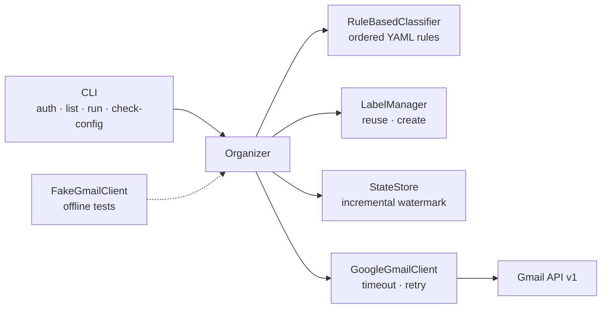

# Gmail Organizer

[](https://github.com/CharlesyWong/gmail-organizer/actions/workflows/ci.yml)


A local, rule-based Gmail automation that reads message **metadata**,
classifies new mail, and applies `Auto/<Category>` labels. Built with the
official Gmail API, OAuth2, pydantic, and pytest.

> **Status:** v1.0.0 — stable, local-first automation. See
> [CHANGELOG.md](CHANGELOG.md) for release history.

## Why this exists

Gmail search is powerful, but triaging a busy inbox still takes manual work.
This project explores a deliberately safe automation pattern:

- read metadata only, never message bodies;
- dry-run by default, with an explicit `--apply`;
- only **add** labels — nothing is deleted, archived, or marked read;
- keep an incremental watermark so daily runs stay small;
- make the whole pipeline testable offline.

The result is a small tool that runs on my PC and a portfolio project that
demonstrates Python, REST/OAuth, pydantic validation, testing, CI, and careful
handling of personal data.

## Features

- Official Gmail API with a desktop OAuth2 flow and token refresh.
- Ordered YAML rules with `all`/`any` matching and subdomain-safe domain checks.
- Dry-run by default; `--apply` is required for any Gmail write.
- Bootstrap, incremental, and full run modes.
- Atomic local watermark with a one-hour overlap; never moves backwards.
- Idempotent label application, case-insensitive reuse, and 409 recovery.
- Per-message failure isolation: one bad message does not abort a run.
- Rotating logs with privacy-safe INFO output; DEBUG is opt-in.
- **149 offline tests at 94% coverage**, with an 85% CI gate on Ubuntu and
  Windows.

## Demo

```text
$ python -m gmail_organizer run --limit 20
DRY RUN — no Gmail changes were made.
would apply: 10
mode: bootstrap
fetched: 20 | classified: 10 | unmatched: 10
categories: Recruiting=10
already labeled: 0 | eligible: 10
labels applied: 0 | labels created: 0
failed: 0
state: unchanged
duration: 9.94s

$ python -m gmail_organizer run --apply --limit 20
APPLY RUN
...
labels applied: 10 | labels created: 1
failed: 0
state: updated

$ python -m gmail_organizer run --apply --full --limit 20
APPLY RUN
mode: full
...
already labeled: 10 | eligible: 0
labels applied: 0 | labels created: 0
```

The re-run applies zero duplicates. Gmail shows one `Auto/Recruiting` label on
10 messages. A fuller transcript lives in [docs/demo.md](docs/demo.md); it
contains counts only, with no sender addresses or subjects.

## Architecture



`Organizer` depends only on the `GmailClient` and `Classifier` protocols. That
keeps the pipeline free of Google imports, makes the test suite fully offline,
and leaves room for an LLM classifier later without restructuring.

## Quickstart

### 1. Install

```powershell
python -m venv .venv
.\.venv\Scripts\python.exe -m pip install -e ".[dev]"
```

### 2. Create Google OAuth credentials

1. In [Google Cloud Console](https://console.cloud.google.com/), create a project
   and enable the **Gmail API**.
2. Open **Google Auth platform → Branding**, set an app name/support email, and
   choose **External** for a personal `@gmail.com` account. Add your account
   under **Audience → Test users**. A Workspace account may use **Internal** if
   the admin allows it.
3. Go to **Credentials → Create credentials → OAuth client ID → Desktop app**.
4. Download the JSON and save it as `.secrets/credentials.json` (gitignored).

### 3. Configure

```powershell
Copy-Item .env.example .env
```

Adjust `GMAIL_QUERY`, limits, or paths if needed.

### 4. Authorize and preview

```powershell
.\.venv\Scripts\python.exe -m gmail_organizer auth
.\.venv\Scripts\python.exe -m gmail_organizer run --limit 20
```

Google shows **“Google hasn’t verified this app”** for a personal OAuth app.
Click **Advanced → Go to … (unsafe)**; this is expected for an unverified app
that you own. Approve the Gmail modify scope.

**Token lifetime:** while the OAuth app is in **Testing**, refresh tokens expire
after 7 days. Before enabling an unattended schedule, publish the app to
**In production** (unverified is fine for personal use) and re-run `auth` once.

## Running it

```powershell
# Preview (default; no Gmail writes)
.\.venv\Scripts\python.exe -m gmail_organizer run

# Apply labels to a bounded scan
.\.venv\Scripts\python.exe -m gmail_organizer run --apply --limit 20

# Deliberate backfill beyond the saved watermark
.\.venv\Scripts\python.exe -m gmail_organizer run --full --limit 100

# Forget the watermark and start over
.\.venv\Scripts\python.exe -m gmail_organizer run --reset-state

# Per-message DEBUG detail (includes sender and subject)
.\.venv\Scripts\python.exe -m gmail_organizer run --verbose
```

### Run modes

- **Bootstrap** — no state file. Scans the base query and processes the newest
  `GMAIL_BOOTSTRAP_LIMIT` messages (default 100).
- **Incremental** — after a successful apply. Adds `after:<watermark - 1h>` to
  the query, capped by `GMAIL_INCREMENTAL_LIMIT` (default 200).
- **Full** — ignores the watermark and rescans the base query.
- On bootstrap, `--limit` sets the backfill depth. Older mail requires `--full`.

### What a run does

1. Fetch metadata only: From, Subject, Date, labels, internal date.
2. Apply rules in order; the first match wins.
3. Reuse an existing `Auto/<Category>` label, or create it once.
4. Skip messages that already have the target label.
5. Add the label with `messages.modify` — never remove, archive, or mark read.
6. On a successful non-dry-run, atomically advance `data/state.json`
   (gitignored). Dry runs and partial failures do not advance it.

## Configuration

Rules live in [`config/rules.yaml`](config/rules.yaml). Validate after editing:

```powershell
.\.venv\Scripts\python.exe -m gmail_organizer check-config
```

The validator enforces:

- `label_prefix` is non-empty; a trailing `/` is normalized away.
- Every rule has a unique `name` and at least one condition.
- `category` may be nested (`Finance/Receipts`) and may repeat across rules.
- `match` is `all` (default) or `any`.
- Conditions:
  - `from_domains` — exact domain or subdomain. `linkedin.com` matches
    `mail.linkedin.com` but never `notlinkedin.com`.
  - `from_contains` — case-insensitive substring of the sender name or address.
  - `subject_contains_any` — case-insensitive substring of the subject.
- Entries within a list are ORed; populated conditions are combined by `match`.
- Rules are evaluated top to bottom, and the first match wins.

Labels are named `<label_prefix>/<category>`, for example `Auto/Recruiting`.
Rule changes only affect messages processed in later runs. Use `--full` to
reclassify older mail; old labels are not removed automatically.

## Logging and diagnostics

- Logs go to stderr and `logs/organizer.log`, rotating at 5 MB with three
  backups. `logs/` is gitignored.
- Default INFO: run mode, counts, created labels, watermark updates, errors.
- Sender and subject appear **only at DEBUG** (`--verbose` or
  `LOG_LEVEL=DEBUG`).
- Tokens, client secrets, message bodies, and raw request headers are never
  logged.
- Per-message failures include the message ID and traceback, but not the subject.
- Unexpected failures exit with code 4 instead of showing a raw traceback.

## Safety and privacy

- No message bodies are downloaded; only From/Subject/Date metadata.
- Dry-run is the default; `--apply` is required to write to Gmail.
- The only Gmail mutation is adding a label. Nothing is deleted or archived.
- Credentials and tokens stay in `.secrets/`; run state stays in
  `data/state.json`. Both are gitignored.
- The program requests `gmail.modify`, the narrowest scope for reading metadata
  and applying labels.
- Per-message failures are isolated and counted; the run does not advance the
  watermark.
- Exit codes: `0` success, `1` partial failures, `2` config/state error,
  `3` auth problem, `4` fatal Gmail API error.

See [SECURITY.md](SECURITY.md) for the security policy and reporting process.

## Testing and quality

```powershell
.\.venv\Scripts\python.exe -m pytest -q
.\.venv\Scripts\python.exe -m pytest --cov=gmail_organizer --cov-report=term-missing
```

- **149 tests**, **94% coverage**.
- All tests run offline with `FakeGmailClient`; no credentials or network.
- CI runs on Ubuntu and Windows and fails below 85% coverage.

## Design decisions and tradeoffs

- **Metadata only.** Safer and cheaper than fetching bodies, but classification
  cannot use body text. A future LLM classifier can work on metadata first.
- **Dry-run default and add-only labels.** Mistakes are visible before they
  happen and are reversible in Gmail; the tool never deletes or archives.
- **Protocol boundaries.** `GmailClient` and `Classifier` are protocols, so the
  pipeline is testable offline and the classifier can be swapped later.
- **First-match rules.** Deterministic and easy to reason about; specificity
  comes from ordering. There is no scoring engine.
- **Local watermark instead of the Gmail History API.** Simple, transparent,
  and inspectable as JSON. The one-hour overlap absorbs date-granularity quirks
  and idempotent label checks make the overlap harmless.
- **No database or web UI in v1.** The CLI, JSON state, and rotating logs are
  enough for a local single-user tool. FastAPI and a thin review UI are roadmap
  items.
- **Labels are not cleaned up.** Reclassification can add a second Auto label;
  cleanup stays manual so the tool never removes user data implicitly.

## Roadmap

- [x] v0.1.0 — config + rule classifier
- [x] v0.2.0 — OAuth + Gmail client
- [x] v0.3.0 — organizer pipeline, labels, watermark
- [x] v0.4.0 — test hardening, logging, exit codes
- [x] v1.0.0 — documented public release
- [ ] v1.1.0 — Windows Task Scheduler
- [ ] v1.2.0 — FastAPI endpoint
- [ ] Later — thin local review UI and optional LLM classifier

## License

MIT — see [LICENSE](LICENSE).
